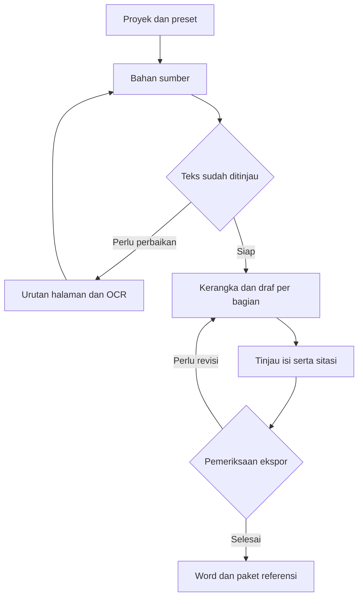

# Academicgent

Rancangan aplikasi lokal untuk membantu menyusun resume, makalah, parafrase, sitasi, artikel ilmiah, skripsi, dan dokumen Word akademik. Fokus awalnya adalah resume yang dapat ditelusuri ke halaman sumber dan diekspor dengan format yang konsisten.

**Draf 0.4 per 7 November 2026.** Alur resume mencakup proyek lokal, PDF, pengurutan halaman, OCR pilihan, koreksi teks, kandidat dari Ollama, riwayat revisi, dan ekspor Word. Versi ini menambahkan buddy dengan enam foto meme, pendamping desktop, serta tugas dan pengingat deadline otomatis. Rancangan makalah, referensi, jurnal, serta skripsi tersedia pada dokumentasi pengembangan.

## Menjalankan di Windows

1. Unduh repositori melalui **Code → Download ZIP**, lalu ekstrak.
2. Pasang Python 3.11 atau lebih baru.
3. Buka `setup.bat` satu kali untuk memasang dependensi. Tahap ini membutuhkan internet.
4. Buka `start.bat`. Academicgent terbuka di browser pada `http://127.0.0.1:8501` dan buddy muncul di desktop.

Untuk menjalankan buddy saja, buka `start_buddy.bat`. Tombol **Buka aplikasi** pada buddy membuka Academicgent dan menjalankan server lokal bila belum aktif. Jika muncul pesan Tcl/Tk, buka **Modify** pada installer Python dan pasang dukungan Tcl/Tk, lalu coba lagi. Belum ada installer `.exe` atau pengaturan agar buddy berjalan otomatis saat masuk Windows.

Pilihan melalui terminal di folder proyek tersedia berikut. Perintah Streamlit ini menjalankan aplikasi browser; buddy desktop dijalankan terpisah.

```powershell
py -3 -m venv .venv
.venv\Scripts\python -m pip install -r requirements.txt
.venv\Scripts\python -m streamlit run app.py
```

```powershell
.venv\Scripts\python desktop_buddy.py
```

## Alur pemakaian

1. **Identitas** — isi nama, NIM, program studi, mata kuliah, dosen, dan judul. Klik **Simpan identitas**.
2. **Bahan PDF** — unggah PDF lalu klik **Baca PDF**. Atur urutan baca, pilih halaman, dan masukkan nomor buku yang tercetak. Nomor PDF selalu mengikuti berkas asli.
3. Periksa pratinjau dan teks. Untuk scan, gunakan **OCR halaman ini** atau **OCR semua halaman kosong**, kemudian koreksi hasil dan centang bahwa teks sudah diperiksa.
4. **Draf resume** — tulis naskah manual atau jalankan model lokal. Kandidat AI dapat ditinjau bersama kutipan sumber sebelum diterapkan sebagai revisi baru.
5. **Ekspor** — unduh Word dari revisi tersimpan. Peta sumber kandidat tersedia bila draf memakai hasil AI. Periksa halaman hasilnya di Word desktop.

Dalam editor, gunakan `## Judul bagian`, `### Subbagian`, dan `- Poin`. Pisahkan paragraf dengan baris kosong. Huruf dan nomor heading dibuat otomatis. Riwayat revisi dapat dipulihkan sebagai revisi baru.

## Buddy dan deadline

Buka tab **Tugas & buddy**, isi nama tugas, tanggal, jam, dan zona waktu **WIB/WITA/WIT**, lalu klik **Simpan tugas**. Pengaturan awal mengingatkan 24 jam sebelum deadline, 1 jam sebelumnya, dan saat jatuh tempo. Pengingat menyediakan **Tunda 15 m**, **Selesai**, serta **Tutup pengingat ini** (di desktop: **Tutup**). Jadwal, penundaan, dan status selesai tersimpan bersama data lokal.

Buddy berganti foto mengikuti proses PDF/OCR/AI, hasil berhasil atau gagal, pertanyaan, perencanaan/koreksi, dan deadline. Foto ditampilkan utuh dengan rasio aslinya. Di tab **Draf resume**, panel **Buddy bantu merencanakan dan mengoreksi** menyusun langkah kerja serta memeriksa struktur dasar naskah; pemeriksaan ini tidak menilai kebenaran isi dengan model AI.

Buddy browser dapat dikecilkan. Buddy desktop berupa foto kecil yang bergerak perlahan. Seret fotonya untuk memindahkan, klik untuk menampilkan pesan, klik dua kali untuk membuka aplikasi, dan klik kanan untuk membuka menu jeda gerakan, pengingat, serta keluar. Saat buddy desktop aktif, pop-up deadline diarahkan ke desktop agar tidak tampil bersamaan di browser.

**Pengingat memerlukan proses buddy yang berjalan.** Menutup browser tetap memungkinkan pengingat desktop jika buddy desktop masih aktif. Laptop mati atau tidur tidak menampilkan pengingat; jadwal yang terlewat diperiksa setelah perangkat dan buddy aktif kembali. Buddy belum berjalan sendiri setelah masuk Windows. Foto bergerak di layar; foto meme tetap berbentuk persegi panjang. Lihat [panduan buddy dan deadline](docs/BUDDY_DAN_DEADLINE.md) untuk enam status, pengaturan, dan cara mencoba.

## Chat AI lokal

Buka tab **Chat AI**, jalankan Ollama dan klik **Cari model lokal**. Pilih model yang telah diunduh, lalu tulis pesan pada kolom chat. Percakapan disimpan sementara selama sesi browser dan dapat dihapus dengan tombol **Hapus percakapan**. Chat dapat menyertakan naskah atau halaman PDF yang telah diperiksa melalui pilihan di tab chat. Konteks dibatasi agar model lokal tetap ringan dan dapat terpotong; periksa rujukan pada PDF asli. Jika permintaan gagal, pesan dapat dikirim ulang selama sesi browser masih terbuka. Periksa jawaban dan sumber sebelum digunakan.

## OCR dan AI lokal

OCR membutuhkan Tesseract dengan paket bahasa Indonesia (`ind`). Aplikasi mendeteksi Tesseract dari PATH, lokasi Windows yang umum, atau variabel `TESSERACT_CMD`. Bahasa yang ditampilkan adalah bahasa yang terpasang. Rotasi dipilih sebelum OCR. Hasil foto yang melengkung atau buram perlu koreksi manual. [Panduan Tesseract](https://tesseract-ocr.github.io/tessdoc/Installation.html)

Untuk AI, pasang Ollama dan unduh model lokal. Kandidat awal pengujian RAM 8 GB adalah `qwen3:1.7b`.

```powershell
ollama pull qwen3:1.7b
```

Jalankan Ollama, buka panel AI di tab Draf resume, lalu klik **Periksa model lokal**. Pilih model dan panjang ringkasan. Aplikasi memproses satu potongan sumber pada satu waktu, dengan konteks 4096 token dan checkpoint tiap hasil. Kualitas ringkasan serta kecepatan perlu diukur pada laptop pengguna. [Ollama](https://ollama.com/download) · [Model contoh](https://ollama.com/library/qwen3:1.7b)

Pembatalan menunggu permintaan AI aktif selesai. Jika aplikasi berhenti mendadak, pekerjaan yang tidak memperbarui checkpoint selama 10 menit ditandai terhenti saat layanan pekerjaan dimuat kembali. Kandidat yang sudah tersimpan dapat dilanjutkan. Setelah sumber diubah, buat generasi baru agar bukti sesuai dengan teks terkini.

## Data dan batas draf

Data berada di folder `AcademicgentData` dalam direktori pengguna. Folder ini berisi `projects.sqlite3` dan `sources/` dengan PDF asli berdasarkan checksum. Database juga menyimpan tugas, pengingat, dan pengaturan buddy. Untuk cadangan lengkap, tutup buddy melalui klik kanan foto lalu **Keluar dari buddy**, hentikan aplikasi Streamlit, lalu salin seluruh folder. Menutup tab browser saja belum menghentikan server. Lokasi dapat diubah melalui `ACADEMICGENT_DATA_DIR` sebelum aplikasi dan buddy dijalankan; keduanya harus memakai lokasi yang sama. Proyek dari P1 dimigrasikan saat dibuka.

Draf ini memakai satu PDF aktif per proyek, maksimal 50 MB dan 100 halaman. Sumber asli disimpan, sedangkan urutan baca dan koreksi teks disimpan di database. Penggantian PDF membuat referensi kandidat lama ditandai perlu ditinjau. Sumber penuh dan berkas tugas berada pada perangkat pengguna.

Peta sumber menunjukkan hubungan kandidat AI dengan potongan halaman. Pemeriksaan kutipan membuktikan keberadaan teks pendukung dalam potongan sumber. Pengguna tetap meninjau kesesuaian makna ringkasan. Pemformatan resume mengikuti preset yang disalin ke proyek.

## Verifikasi pengembang

```powershell
.venv\Scripts\python -m unittest discover -s tests -v
```

Pada draf 0.3, 16 pengujian otomatis lulus, mencakup alur resume serta status buddy, deadline, zona waktu, pengingat yang terlewat, penundaan, dan konflik perubahan tugas. Tiga alur AppTest dijalankan ulang setelah perbaikan label tombol dan lulus. Interaksi browser diperiksa pada ukuran 1440 × 1000 dan 390 × 844; buddy desktop diperiksa melalui Tk di Linux dengan layar virtual. Catatan uji OCR dan render Word dari draf 0.2 dipertahankan terpisah pada [hasil verifikasi dan batas draf](docs/STATUS_DRAF.md).

Pengujian integrasi AI memakai server lokal dengan respons terkontrol. Kualitas model sungguhan, penggunaan RAM, kecepatan, buddy di Windows, dan hasil Microsoft Word desktop masih perlu diperiksa di laptop pengguna.

## Mulai membaca

| Dokumen | Isi |
| --- | --- |
| [Status draf](docs/STATUS_DRAF.md) | Fitur yang tersedia, hasil uji, batas versi, dan langkah mencoba di laptop |
| [Buddy dan deadline](docs/BUDDY_DAN_DEADLINE.md) | Enam status meme, pendamping desktop, tugas, pop-up pengingat, dan batas operasional |
| [Arsitektur](docs/ARSITEKTUR.md) | Komponen lokal, pilihan teknologi, penyimpanan, pemrosesan AI, ekspor, dan pemulihan pekerjaan |
| [Alur pengguna](docs/ALUR_PENGGUNA.md) | Resume PDF, makalah, parafrase, Mendeley, artikel jurnal, skripsi, dan perapian Word |
| [Kontrak data](docs/KONTRAK_DATA.md) | Struktur proyek, halaman sumber, bukti, draf, sitasi, versi, dan hasil ekspor |
| [Template dan sumber](docs/TEMPLATE_DAN_SUMBER.md) | Temuan dari SINTA, Scholar, ResearchGate, jurnal penerbit, APA, dan IEEE |
| [Roadmap dan uji](docs/ROADMAP_DAN_UJI.md) | Tahap implementasi beserta syarat kelulusan setiap tahap |
| [Preset resume](templates/presets/resume-v0.1.json) | Format awal yang diturunkan dari contoh pengguna |
| [Preset makalah kuliah](templates/presets/makalah-kuliah-v0.1.json) | Aturan A4, Times New Roman, margin 4/3/3/3 cm, dan spasi 1,5 |

## Keputusan awal

- Antarmuka berbahasa Indonesia melalui browser lokal. Python dan Streamlit dipilih untuk implementasi pertama.
- Target awal Windows pada laptop i3 generasi ke-13, RAM 8 GB, dan SSD 512 GB. Model dan kapasitas konteks ditentukan melalui uji perangkat. Upgrade RAM dicatat sebagai opsi.
- Proyek dan draf tersimpan di SQLite serta folder data aplikasi lokal. Profil mahasiswa diisi ketika aplikasi pertama dijalankan.
- Ollama menjalankan satu model lokal dan satu pekerjaan generasi pada satu waktu. Pengguna dapat menyunting serta mengekspor teks ketika layanan AI sedang tidak tersedia.
- Format dokumen berasal dari preset yang berversi. Pemilihan gaya sitasi dan aturan tata letak dicatat sebagai dua pengaturan proyek.
- Referensi tersimpan sebagai CSL-JSON. Pandoc citeproc direncanakan saat fitur sitasi masuk, lalu RIS menjadi jalur pemindahan referensi ke Mendeley.
- Format resume awal mengikuti contoh pengguna. APA, IEEE, dan template jurnal adalah calon preset tambahan yang memerlukan validasi masing-masing.



## Alur yang tersedia

Pengguna dapat menyimpan proyek, membaca dan mengoreksi bahan PDF, menyusun naskah, meninjau kandidat AI, serta mengunduh Word yang mengikuti contoh resume. Buddy mendampingi proses dan menampilkan pengingat dari daftar tugas lokal.

## Batas keputusan yang masih terbuka

Model AI, kecepatan generasi, dan ukuran konteks menunggu pengukuran di laptop. Preset skripsi Sistem Informasi IPI memerlukan pedoman program studi yang berlaku. Katalog template jurnal mencatat tingkat verifikasi sumber dan tanggal pemeriksaan. Target kompatibilitas akhir adalah Word desktop pada perangkat pengguna.

Repositori publik ini menyimpan rancangan dan preset generik. Penyimpanan profil, berkas kuliah, hasil ekstraksi, dan dokumen tugas dirancang di direktori data aplikasi pada laptop.
