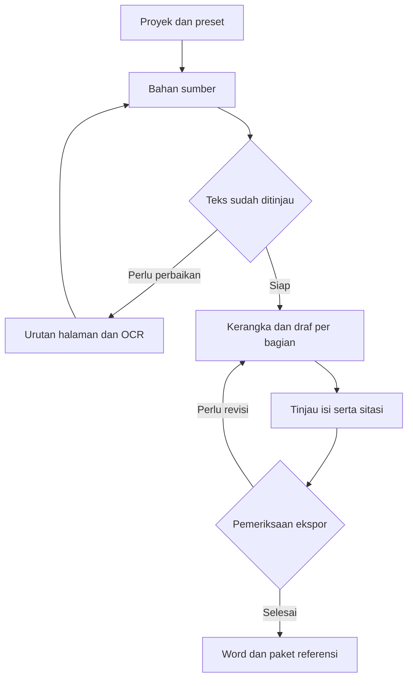

# Academicgent

Rancangan aplikasi lokal untuk membantu menyusun resume, makalah, parafrase, sitasi, artikel ilmiah, skripsi, dan dokumen Word akademik. Fokus awalnya adalah resume yang dapat ditelusuri ke halaman sumber dan diekspor dengan format yang konsisten.

**Status per 6 November 2026 — P1 prototipe resume.** Repositori ini memuat rancangan lengkap dan aplikasi awal untuk mengisi, menyimpan, mengedit kembali, serta mengekspor resume ke Word. Pengolahan PDF dan AI lokal menyusul sesuai roadmap. Berkas JSON dalam `templates/presets` adalah spesifikasi calon template.

## Menjalankan prototipe

Di Windows, pasang Python 3.11 atau lebih baru. Pada terminal di folder proyek jalankan:

```powershell
py -m venv .venv
.venv\Scripts\python -m pip install -r requirements.txt
.venv\Scripts\python -m streamlit run app.py
```

Browser akan membuka antarmuka lokal. Isi identitas, mata kuliah, judul, dan naskah. Awali bagian dengan `##`, subbagian dengan `###`, dan poin dengan `-`. Klik **Simpan dan siapkan Word**, lalu **Unduh Word**. Pilih proyek dari daftar untuk membukanya lagi. Data disimpan di `AcademicgentData` pada direktori pengguna Windows. Ekspor Word mengikuti preset resume 0.1.

## Mulai membaca

| Dokumen | Isi |
| --- | --- |
| [Arsitektur](docs/ARSITEKTUR.md) | Komponen lokal, pilihan teknologi, penyimpanan, pemrosesan AI, ekspor, dan pemulihan pekerjaan |
| [Alur pengguna](docs/ALUR_PENGGUNA.md) | Resume PDF, makalah, parafrase, Mendeley, artikel jurnal, skripsi, dan perapian Word |
| [Kontrak data](docs/KONTRAK_DATA.md) | Struktur proyek, halaman sumber, bukti, draf, sitasi, versi, dan hasil ekspor |
| [Template dan sumber](docs/TEMPLATE_DAN_SUMBER.md) | Temuan dari SINTA, Scholar, ResearchGate, jurnal penerbit, APA, dan IEEE |
| [Roadmap dan uji](docs/ROADMAP_DAN_UJI.md) | Tahap implementasi beserta syarat kelulusan setiap tahap |
| [Preset resume](templates/presets/resume-v0.1.json) | Format awal yang diturunkan dari contoh pengguna |
| [Preset makalah kuliah](templates/presets/makalah-kuliah-v0.1.json) | Aturan A4, Times New Roman, margin 4/3/3/3 cm, dan spasi 1,5 |

## Keputusan awal

- Antarmuka berbahasa Indonesia melalui browser lokal. Python dan Streamlit dipilih untuk implementasi pertama.
- Target awal Windows pada laptop i3 generasi ke-13, RAM 8 GB, dan SSD 512 GB. Model dan kapasitas konteks ditentukan melalui uji perangkat. Upgrade RAM dicatat sebagai opsi.
- Proyek dan draf tersimpan di SQLite serta folder data aplikasi lokal. Profil mahasiswa diisi ketika aplikasi pertama dijalankan.
- Ollama menjalankan satu model lokal dan satu pekerjaan generasi pada satu waktu. Pengguna dapat menyunting serta mengekspor teks ketika layanan AI sedang tidak tersedia.
- Format dokumen berasal dari preset yang berversi. Pemilihan gaya sitasi dan aturan tata letak dicatat sebagai dua pengaturan proyek.
- Referensi tersimpan sebagai CSL-JSON. Pandoc citeproc direncanakan saat fitur sitasi masuk, lalu RIS menjadi jalur pemindahan referensi ke Mendeley.
- Format resume awal mengikuti contoh pengguna. APA, IEEE, dan template jurnal adalah calon preset tambahan yang memerlukan validasi masing-masing.



## Hasil pertama

Pengguna dapat mengisi identitas dan judul, memasukkan isi resume, menyimpan revisinya, serta mengunduh Word yang mengikuti contoh. Ekspor diuji dengan contoh pendek dan panjang melalui render halaman. Pengerjaan berikutnya adalah PDF, urutan halaman, OCR, dan AI lokal. PDF Bab 12 dan contoh resume pengguna menjadi bahan uji privat ketika tersedia di perangkat.

## Batas keputusan yang masih terbuka

Model AI, kecepatan generasi, dan ukuran konteks menunggu pengukuran di laptop. Preset skripsi Sistem Informasi IPI memerlukan pedoman program studi yang berlaku. Katalog template jurnal mencatat tingkat verifikasi sumber dan tanggal pemeriksaan. Target kompatibilitas akhir adalah Word desktop pada perangkat pengguna.

Repositori publik ini menyimpan rancangan dan preset generik. Penyimpanan profil, berkas kuliah, hasil ekstraksi, dan dokumen tugas dirancang di direktori data aplikasi pada laptop.
