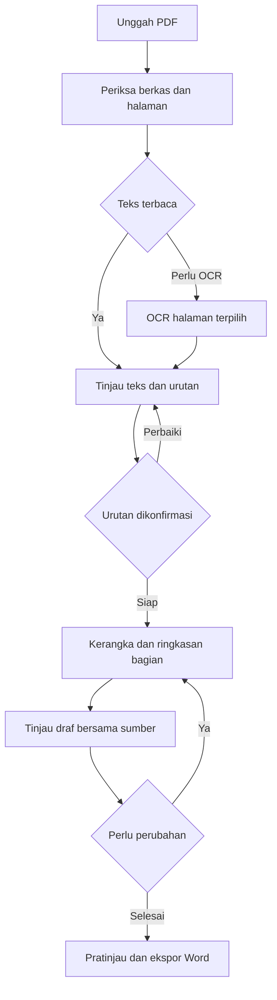
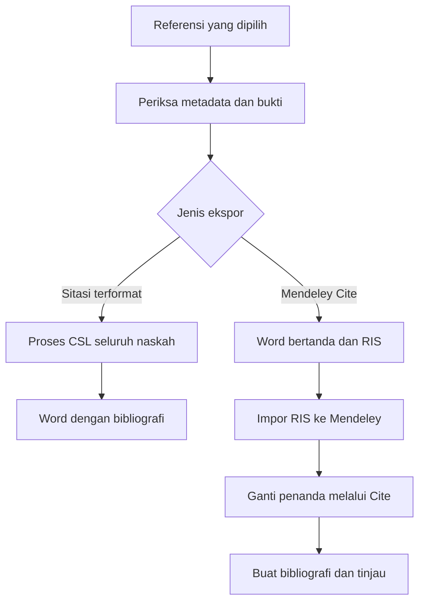
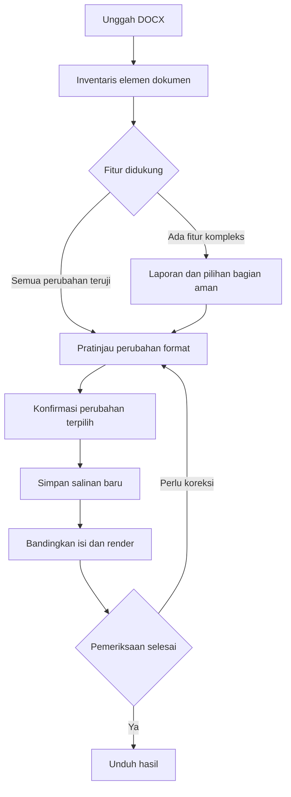

# Alur penggunaan Academicgent

Dokumen ini menjelaskan perilaku yang akan dibangun. Urutan implementasinya tercantum pada [roadmap](ROADMAP_DAN_UJI.md).

## Navigasi aplikasi

| Layar | Tindakan utama | Hasil tersimpan |
| --- | --- | --- |
| Proyek | Buat proyek, lanjutkan pekerjaan, buat cadangan | Jenis tugas, judul, status, revisi terakhir |
| Bahan | Unggah, tinjau teks, atur halaman, pilih sumber | Sumber asli, teks ekstraksi, urutan yang dikonfirmasi |
| Kerangka | Tambah, pindah, dan ubah bagian | Struktur dokumen dan hubungan ke bahan |
| Editor | Tulis, ringkas, parafrase bagian terpilih, bandingkan kandidat | Draf per bagian dan riwayat revisi |
| Referensi | Impor RIS, isi DOI, perbaiki metadata, pilih gaya | Referensi dan status pemeriksaannya |
| Pemeriksaan | Tinjau klaim, locator, format, serta bagian yang belum selesai | Daftar masalah dan keputusan pengguna |
| Ekspor | Pilih Word atau persiapan Mendeley, lihat halaman | Hasil ekspor berversi dan peta sitasi |
| Pengaturan | Profil lokal, preset, model, lokasi cadangan | Pengaturan perangkat dan profil |

Navigasi menampilkan tahap yang sudah tersedia pada versi aplikasi. Editor utama memakai bagian dokumen yang terstruktur. Panel chat dapat ditambahkan untuk revisi bagian terpilih setelah alur dasar stabil. Perintah perubahan selalu menghasilkan kandidat yang dapat dibandingkan dan diterapkan pengguna.

## Pertama kali membuka aplikasi

1. Isi nama, NIM, dan program studi. Nilai ini dapat diedit per proyek.
2. Pilih preset dan isi mata kuliah, dosen, serta judul.
3. Pemeriksaan perangkat menampilkan status model, pembaca PDF, OCR, font, dan renderer sesuai fitur yang dipilih.
4. Buat proyek. Aplikasi menyimpan snapshot identitas dan preset untuk dokumen tersebut.
5. Masukkan teks atau bahan sumber, kemudian lanjutkan pada alur jenis tugas.

## Resume dari PDF

Halaman ditampilkan dengan tiga informasi terpisah yaitu posisi dalam PDF, nomor tercetak pada buku, dan urutan baca pilihan pengguna. Nomor tercetak boleh kosong, berupa angka Romawi, atau memiliki awalan. Dugaan urutan otomatis harus ditinjau. Halaman duplikat, hilang, dan dua halaman buku dalam satu gambar ditandai untuk diperiksa. Pemotongan gambar menjadi dua halaman adalah fitur lanjutan. Pada versi awal, pengguna dapat mengoreksi teks dan urutan bagian secara manual.

Pengguna memilih cakupan dan tingkat ringkasan singkat, sedang, atau rinci. Target panjang diperlakukan sebagai perkiraan. Struktur mengikuti subbab sumber. Penomoran huruf bertambah sesuai jumlah bagian. A–G pada contoh Bab 12 adalah hasil struktur bab tersebut.

Setiap bagian memperlihatkan potongan pendukung di panel sumber. Rentang halaman yang tampil pada judul berasal dari halaman tercetak yang dikonfirmasi. Bila halaman pendukung terputus, aplikasi menampilkan daftar atau beberapa rentang, misalnya 227–229 dan 233. Ketika nomor buku belum diketahui, label memakai “halaman PDF”.

Hasil ringkasan hanya menggunakan bahan yang dipilih. Sumber luar dapat ditambahkan sebagai tindakan pengguna dengan identitas sumber yang jelas. Kutipan sumber sekunder dalam buku diberi status sumber sekunder sampai artikel aslinya benar-benar diperiksa.

## Makalah

1. Pilih preset makalah kuliah dan masukkan instruksi dosen, topik, identitas, serta target panjang.
2. Tambahkan bahan. Saat online, pencarian dapat dimulai dari DOI atau kata kunci, kemudian pengguna memilih publikasi dan menambahkan teks yang dapat dibaca.
3. Aplikasi menawarkan kerangka yang dapat diubah. Struktur awal makalah kuliah dapat mencakup pendahuluan, pembahasan, penutup, dan daftar pustaka sesuai tugas.
4. Tentukan sumber pendukung setiap bagian. Klaim tanpa bukti diberi penanda “perlu sumber”.
5. Buat draf per subbagian, tinjau argumen, contoh, istilah, dan hubungan antarbab.
6. Pilih gaya sitasi. Pemeriksaan mencocokkan kutipan dengan daftar pustaka serta menandai metadata yang belum lengkap.
7. Tinjau halaman Word dan pilih cara ekspor sitasi.

Judul saja cukup untuk mengusulkan kerangka. Penulisan pembahasan yang berbasis sumber membutuhkan bahan. Data penelitian, hasil wawancara, statistik, dan temuan lapangan dimasukkan atau diverifikasi pengguna sebelum digunakan.

## Parafrase

Pengguna memilih paragraf beserta sitasinya dan tujuan perubahan, seperti lebih ringkas atau lebih formal. Sistem menyimpan teks asli dan membuat kandidat di sisi sebelahnya. Angka, nama, istilah teknis, batasan temuan, serta hubungan sitasi ditampilkan dalam pemeriksaan perubahan. Pengguna menerima atau menolak kandidat. Setelah teks diterapkan, bagian terkait memperoleh revisi baru dan status pemeriksaan bukti kembali terbuka. Kutipan langsung dapat dipertahankan sebagai kutipan atau diubah menjadi parafrase dengan pencatatan sumber.

## Referensi dan Mendeley

Peta sitasi menyimpan ID penanda, paragraf tujuan, cuplikan konteks, referensi yang tergabung, locator halaman, jenis kutipan, serta gaya naratif atau parentetik. Penanda contoh adalah `[[CIT:c001]]`. Pengguna mengganti seluruh penanda dengan hasil Mendeley Cite. Daftar pustaka dibuat lewat add-in setelah pemasangan sitasi. Pemindaian sisa penanda membantu memeriksa kelengkapan, dan pengguna memastikan field Mendeley aktif bekerja di Word.

Untuk beberapa karya penulis pada tahun sama, kutipan berulang, dan nomor IEEE, formatter harus memproses urutan seluruh naskah. Mode terformat dan mode Mendeley menjalani uji masing-masing. [Impor RIS](https://static.mendeley.com/md-stitch/releases/live/02-adding-references.e005845c.html) · [Mendeley Cite](https://www.mendeley.com/reference-management/mendeley-cite)

## Artikel jurnal

Pengguna memilih jurnal tujuan, membuka pedoman resmi, dan memeriksa versi template. Aplikasi menampilkan bahasa naskah, susunan bagian, ukuran teks, batas abstrak, panjang naskah, serta gaya referensi yang sudah diverifikasi. Nilai yang belum diketahui ditandai pada preset. Jika pedoman dan file template berbeda, konflik ditinjau sebelum preset dinyatakan siap.

Proyek kemudian memakai alur makalah dengan pemeriksaan jurnal tambahan. Susunan penulis, afiliasi, corresponding author, bahasa abstrak, tabel, dan gambar mengikuti jurnal tujuan. Pengguna dapat mengekspor draf selama preset masih dalam tahap verifikasi, dengan status tersebut terlihat dalam laporan pemeriksaan.

## Skripsi

1. Masukkan pedoman program studi yang berlaku dan konfirmasikan aturan format.
2. Buat struktur bab berdasarkan jenis penelitian dan pedoman.
3. Tambahkan bahan pustaka, rumusan masalah, tujuan, metode, dan bahan penelitian pengguna.
4. Kerjakan satu subbab pada satu waktu. Bagian temuan mengacu pada data atau hasil analisis yang tersedia.
5. Simpan catatan istilah, keputusan metode, variabel, dan revisi agar antarbab konsisten.
6. Tinjau hubungan masalah, tujuan, metode, hasil, dan kesimpulan.
7. Gabungkan versi bab yang dipilih. Bangun daftar isi, daftar gambar, daftar tabel, caption, lampiran, serta halaman awal dan isi sesuai pedoman.
8. Perbarui field dan periksa seluruh halaman di Word. Tandai versi yang siap dibawa ke pembimbing.

Preset Sistem Informasi IPI menunggu dokumen resmi yang sesuai program studi dan angkatan. Penelusuran awal menemukan pedoman PGSD dan tesis Teknologi Pendidikan, sehingga kecocokan pedoman SI masih menjadi pekerjaan terbuka. [Catatan sumber](TEMPLATE_DAN_SUMBER.md)

## Merapikan Word yang sudah ada

Inventaris mencakup section, styles, tabel, gambar, footnote, komentar, track changes, content control, rumus, field daftar isi, dan objek sitasi. Dukungan ditambahkan melalui fixture yang benar-benar diuji. Format rumit atau objek yang belum didukung masuk laporan pemeriksaan. Perubahan yang disetujui diterapkan pada salinan, dengan pemeriksaan isi dan relasi berkas setelah penyimpanan. Untuk dokumen Mendeley, uji khusus memastikan kemampuan mengubah gaya dan memperbarui bibliografi tetap bekerja.

## Menyimpan dan melanjutkan pekerjaan

Setiap perubahan yang diterapkan menghasilkan revisi. Generasi ulang menyimpan kandidat, sehingga pengguna dapat membandingkannya dengan draf aktif. Jika model berhenti, pengguna dapat mengekspor draf yang sudah ada atau melanjutkan bagian yang gagal. Perubahan bahan atau urutan halaman membuat hasil turunannya berstatus perlu ditinjau. Layar proyek memperlihatkan pekerjaan terakhir, checkpoint, dan langkah yang perlu dilanjutkan.
