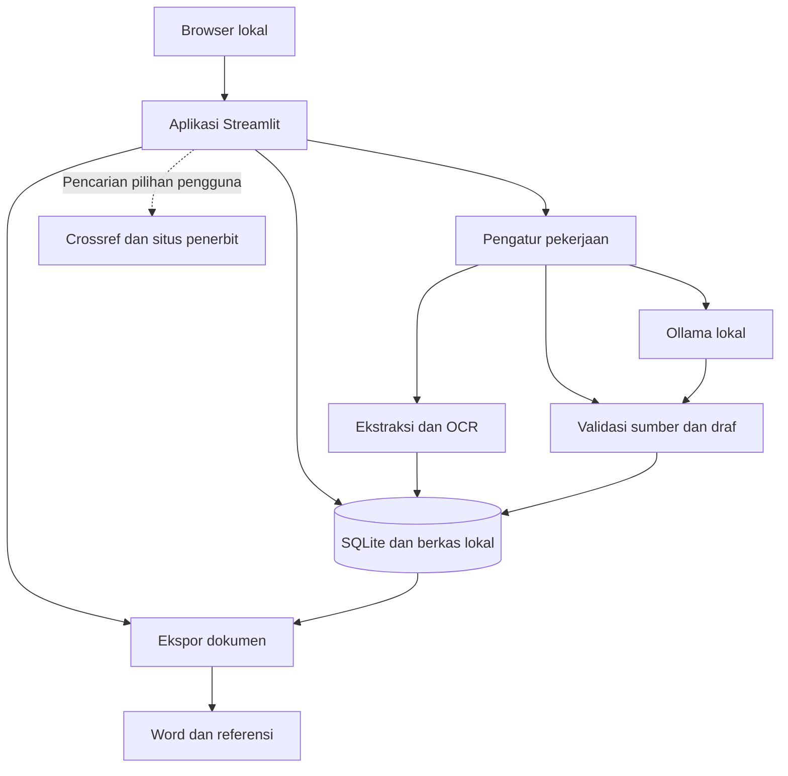

# Arsitektur Academicgent

Versi rancangan 0.1 • 6 November 2026

## Sasaran dan cakupan

Academicgent membantu satu pengguna mengolah bahan akademik menjadi dokumen yang dapat disunting, ditelusuri sumbernya, dan diekspor ke Word. Pengerjaan dimulai dari resume, lalu meluas ke makalah, parafrase, sitasi, artikel jurnal, skripsi, dan perapian dokumen lama. Setiap tahap memiliki kriteria pada [roadmap](ROADMAP_DAN_UJI.md).

Istilah agent di proyek ini berarti alur kerja terarah yang memanggil pembaca dokumen, model bahasa, pemeriksa referensi, dan generator Word. Aplikasi menjalankan langkah yang jelas dengan titik tinjau pengguna pada urutan bahan, kerangka, dan hasil penulisan.

## Komponen dan batas proses

Aplikasi dan Ollama berjalan sebagai proses lokal yang berbeda. Pengatur pekerjaan ada dalam proses aplikasi dengan satu worker. Data tahan lama tersimpan di disk. Antarmuka hanya menampilkan status pekerjaan yang tersimpan. Jaringan digunakan untuk unduhan awal, pencarian metadata yang diminta pengguna, dan layanan eksternal yang dipilihnya.

## Pilihan teknologi

| Bagian | Pilihan awal | Peran dan tahap |
| --- | --- | --- |
| Antarmuka | Python dan Streamlit | Formulir, editor per bagian, tabel urutan halaman, status proses, unduhan |
| Penyimpanan | `sqlite3` dari Python dan filesystem | Metadata, revisi draf, pekerjaan, referensi, serta berkas sumber |
| Validasi | Pydantic | Memeriksa struktur masukan, preset, dan keluaran AI saat implementasi dimulai |
| Word tahap pertama | `python-docx` | Template resume, paragraf, identitas, styles, header, footer, dan field nomor halaman |
| PDF | `pypdf` dan `pypdfium2` | Ekstraksi teks dan render pratinjau per halaman, setelah ekspor Word stabil |
| OCR | Tesseract dengan bahasa Indonesia dan Inggris | Membaca halaman hasil scan yang dipilih pengguna pada tahap PDF |
| AI | Ollama melalui API lokal | Draf, ringkasan, parafrase, dan usulan struktur per bagian |
| Sitasi | CSL-JSON dan Pandoc citeproc | Pemformatan sitasi dokumen secara menyeluruh pada tahap referensi |
| Referensi eksternal | Crossref REST API | Menawarkan metadata DOI atau kandidat judul, dengan konfirmasi kecocokan |
| Pratinjau ekspor | LibreOffice headless bila tersedia | Render Word ke PDF untuk tinjau halaman, disertai uji Word desktop |

Ketergantungan dipasang sesuai tahap dan dikunci versinya setelah diuji. PDF hasil scan memerlukan OCR tersendiri. Teks hasil ekstraksi bisa kehilangan urutan baca, tabel, dan rumus sehingga ada layar pemeriksaan sebelum generasi. [Dokumentasi pypdf](https://pypdf.readthedocs.io/en/stable/user/extract-text.html)

## Modul aplikasi yang direncanakan

| Lokasi rencana | Tanggung jawab |
| --- | --- |
| `app.py` | Menampilkan proyek, formulir, editor, dan hasil pemeriksaan |
| `academicgent/storage.py` | Transaksi SQLite, revisi, dan penyimpanan berkas |
| `academicgent/documents.py` | Model data dan validasi masukan serta dokumen |
| `academicgent/ingest.py` | PDF, DOCX, OCR, pemetaan halaman, dan potongan sumber |
| `academicgent/generation.py` | Menyusun masukan model dan memvalidasi keluaran |
| `academicgent/jobs.py` | Antrean tunggal, pembatalan, retry, dan checkpoint |
| `academicgent/references.py` | Metadata, deduplikasi, CSL, RIS, dan peta sitasi |
| `academicgent/export.py` | Memilih renderer, menerapkan preset, dan memeriksa hasil |
| `templates/presets/` | Spesifikasi format berversi |

Modul dibuat saat fiturnya diimplementasikan. Fungsi antarmuka memanggil logika aplikasi secara langsung. Format pertukaran internal mengikuti [kontrak data](KONTRAK_DATA.md).

## Penyimpanan proyek

Direktori awal Windows adalah `%LOCALAPPDATA%/Academicgent/`, dengan satu `academicgent.sqlite3`, direktori berkas berdasarkan ID proyek, serta folder cadangan dan ekspor. Nama berkas masukan disimpan sebagai metadata, sedangkan nama di disk dibuat oleh aplikasi. Sumber asli disimpan dengan checksum SHA-256. Perubahan urutan halaman disimpan sebagai peta versi baru.

SQLite menyimpan profil lokal, proyek, metadata sumber, revisi, pekerjaan, dan catatan validasi. Berkas besar berada di disk dengan path relatif terhadap direktori data. Setiap proyek menyimpan salinan aturan preset yang dipilih sehingga pembaruan preset berlaku untuk proyek baru atau migrasi yang disetujui pengguna.

Penyimpanan draf terjadi setelah tindakan Simpan atau checkpoint yang jelas. Antarmuka menunjukkan status perubahan yang belum disimpan. Pembaruan menyertakan nomor revisi yang dibaca. Bila tab lain sudah menyimpan revisi baru, aplikasi meminta pengguna membandingkan perubahan. Pembaruan database dalam transaksi menjaga revisi dan isi tetap konsisten.

Untuk berkas, tulis ke nama sementara di filesystem yang sama, selesaikan penulisan, lalu lakukan rename atomik sebelum memasukkan referensinya ke database. Crash di antara rename dan transaksi dapat menyisakan berkas tanpa referensi. Saat startup, aplikasi mencatat dan membersihkan berkas sementara atau orphan setelah masa tenggang. Kegagalan transaksi mempertahankan revisi lama. Ekspor memakai nama berisi nomor revisi sehingga hasil sebelumnya tersedia.

Cadangan dibuat dengan API backup SQLite dan salinan berkas yang dirujuk, ketika antrean mutasi berhenti sementara. Manifest berisi versi skema, daftar berkas, dan checksum. Pemulihan diekstrak ke direktori baru, diverifikasi, lalu diaktifkan setelah validasi. Migrasi skema memiliki cadangan awal dan nomor versi.

## Pekerjaan panjang dan pemulihan

Streamlit menjalankan ulang skrip saat interaksi. Session State digunakan untuk pilihan tampilan, sedangkan proyek dan progres pekerjaan berada di SQLite. Tombol menghasilkan ID pekerjaan, kemudian worker memprosesnya. [Dokumentasi Streamlit](https://docs.streamlit.io/develop/concepts/architecture/session-state)

Status pekerjaan adalah `queued`, `running`, `succeeded`, `failed`, `cancelled`, atau `interrupted`. Hanya satu pekerjaan berat berjalan per instalasi. Pengambilan pekerjaan terjadi melalui transaksi, dengan kendala satu job `running`. Submit berulang dengan kunci deduplikasi yang sama mengembalikan pekerjaan yang sedang aktif.

Identitas pekerjaan mencakup ID proyek, versi urutan halaman, revisi masukan, checksum sumber, preset, model, versi prompt, dan operasi yang diminta. Checkpoint disimpan setelah setiap halaman OCR atau bagian draf selesai. Saat restart, status `running` lama berubah menjadi `interrupted`. Pengguna dapat melanjutkan dari checkpoint yang cocok dengan masukan terkini. Jika masukan berubah, pekerjaan baru dibuat.

Pembatalan diperiksa antarlangkah dan menutup permintaan model yang sedang diproses bila tersedia. Hasil parsial yang telah selesai disimpan sebagai draf. Respons yang terlambat dari job lama hanya disimpan sebagai kandidat versi job tersebut. Penerapan ke draf aktif memeriksa revisi sumber kembali.

## Alur AI dan penggunaan memori

1. Pengguna meninjau teks hasil ekstraksi dan urutan halaman.
2. Aplikasi membagi teks menurut judul dan paragraf, dengan batas ukuran masukan model. Halaman dan ID potongan dibawa ke setiap bagian.
3. Model menghasilkan ringkasan sumber beserta ID bukti. Aplikasi memeriksa bahwa semua ID berasal dari bagian yang dikirim.
4. Kerangka disusun dari catatan tersebut, lalu ditinjau pengguna.
5. Setiap bagian draf menerima kerangka, ringkasan bagian sebelumnya, istilah proyek, dan potongan sumber yang relevan. Versi lengkap sumber tetap tersedia untuk peninjauan.
6. Keluaran harus sesuai skema. Satu percobaan perbaikan struktur diperbolehkan, kemudian pekerjaan ditandai perlu perhatian jika tetap gagal.

Ollama mendukung keluaran terstruktur berbasis JSON Schema. Pemeriksaan skema memastikan bentuk data, sementara pemeriksaan makna tetap dilakukan terhadap sumber dan oleh pengguna. [Dokumentasi Ollama](https://docs.ollama.com/capabilities/structured-outputs)

Untuk RAM 8 GB, hipotesis awal pengujian adalah satu model terkuantisasi sekitar 1–2B, satu request aktif, dan konteks 2.048–4.096 token. Angka ini adalah rentang eksperimen. Pengukuran menetapkan konfigurasi akhir. Konteks mencakup instruksi, bahan, dan keluaran, sehingga anggaran input harus menyisakan ruang untuk jawaban. Jika terlalu panjang, aplikasi membagi bagian kembali sebelum memanggil model. Peningkatan konteks menambah kebutuhan memori. [Dokumentasi konteks Ollama](https://docs.ollama.com/context-length)

Pratinjau PDF memuat halaman yang terlihat. OCR bekerja berurutan. Hasil ekstraksi disimpan sehingga pembukaan proyek berikutnya memakai hasil yang sudah ada. Pencarian sumber awal menggunakan pilihan pengguna dan pencarian teks lokal. Embedding baru dievaluasi bila kebutuhan pencarian koleksi besar terbukti dalam penggunaan.

## Sumber dan referensi

Setiap referensi mempunyai status metadata dan status dukungan isi yang terpisah. Metadata DOI yang cocok menunjukkan identitas publikasi. Dukungan terhadap klaim dinilai dari teks atau halaman sumber yang dibaca. Crossref membantu mengambil metadata, dan kandidat hasil pencarian judul harus dikonfirmasi pengguna. [Crossref REST API](https://www.crossref.org/documentation/retrieve-metadata/rest-api/)

Mode offline menggunakan bahan yang telah tersimpan, preset, CSL, dan model yang telah diunduh. Pencarian internet mengirim DOI atau kata kunci yang dipilih pengguna. Mendeley Cite memiliki alur akun dan sinkronisasi cloud sendiri. [Panduan Mendeley Cite](https://static.mendeley.com/md-stitch/releases/live/mendeley-cite-introduction.0d18bf79.html)

## Ekspor Word dan Mendeley

Resume awal dihasilkan langsung oleh `python-docx`. Saat makalah bersitasi ditambahkan, Pandoc memproses keseluruhan naskah terstruktur, CSL-JSON, dan file CSL menuju DOCX dengan `reference-doc`. `python-docx` menambahkan blok identitas dan menyesuaikan properti yang diuji. Styles dan layout keduanya bersumber dari preset yang sama. Sitasi diproses pada seluruh dokumen agar urutan numerik dan disambiguasi penulis konsisten. [Pandoc User’s Guide](https://pandoc.org/MANUAL.html)

Ekspor bersitasi mempunyai dua pilihan yang tertulis jelas di antarmuka.

| Pilihan | Isi keluaran | Langkah pengguna |
| --- | --- | --- |
| Word dengan sitasi terformat | DOCX dengan teks sitasi dan daftar pustaka, serta RIS bila diminta | Tinjau isi, metadata, dan layout sebelum digunakan |
| Persiapan Mendeley Cite | DOCX dengan penanda lokasi, RIS, dan peta sitasi berisi ID, kutipan konteks, locator, serta saran gaya | Impor RIS, ganti setiap penanda melalui add-in, buat bibliografi melalui add-in, lalu cek sisa penanda |

RIS memasukkan referensi ke koleksi Mendeley. Field sitasi aktif dibuat melalui Mendeley Cite di Word. Mode persiapan menghindari bibliografi ganda dengan menempatkan daftar verifikasi sumber di peta sitasi terpisah. [Impor referensi](https://static.mendeley.com/md-stitch/releases/live/02-adding-references.e005845c.html) · [Fungsi Mendeley Cite](https://www.mendeley.com/reference-management/mendeley-cite)

Ekspor menyimpan revisi, checksum preset, versi renderer, dan gaya sitasi. Setelah validasi struktur DOCX, pengguna melihat PDF hasil render jika tersedia. Pembaruan daftar isi dan field dilakukan oleh Word atau renderer yang mendukungnya. Pemeriksaan akhir memakai Word desktop karena pergantian font dan mesin layout dapat mengubah posisi halaman.

## Validasi dan penanganan masukan

Semua unggahan diperiksa berdasarkan jenis nyata, ukuran, dan kemampuan pembaca. Batas awal yang akan diuji adalah 50 MB per berkas dan 100 halaman per batch. Parser berjalan dalam proses yang dapat dihentikan saat timeout atau penggunaan memori berlebihan. Ekstraksi ZIP/DOCX memeriksa total ukuran terurai, jumlah entri, dan path. Dokumen dengan password menghasilkan permintaan pembukaan oleh pengguna.

Masukan pengguna, PDF, dan keluaran model diperlakukan sebagai isi dokumen. Instruksi di dalam sumber tidak mendapat hak menjalankan program atau mengubah konfigurasi. Aplikasi hanya menerima operasi yang tersedia di antarmuka, membatasi tipe berkas, dan memakai argumen subprocess terpisah. Tampilan menyaring HTML dari isi sumber.

Layanan UI dan Ollama diarahkan ke loopback. Proteksi XSRF serta origin bawaan antarmuka dipertahankan. Identitas, isi tugas, dan isi prompt disimpan pada perangkat. Log aplikasi mencatat status, durasi, dan ID pekerjaan, dengan isi dokumen hanya ketika mode diagnostik dipilih pengguna.

| Kondisi | Respons aplikasi |
| --- | --- |
| Ollama belum tersedia atau model belum diunduh | Editor dan ekspor tetap tersedia, panel AI memberikan petunjuk setup |
| OCR rendah kualitas atau rumus sulit dibaca | Halaman ditandai untuk diperbaiki dan ditinjau pengguna |
| Ruang disk kurang | Operasi dihentikan sebelum menulis hasil final, revisi sebelumnya tersedia |
| DOI gagal ditemukan | Metadata tetap berstatus belum diverifikasi, pengguna dapat memperbaiki atau mengisi manual |
| ID sitasi tidak ditemukan | Ekspor bersitasi meminta perbaikan hubungan data |
| Font atau renderer belum tersedia | Aplikasi menampilkan prasyarat dan status pemeriksaan layout |
| Format jurnal berubah | Proyek mempertahankan snapshot preset, pengguna dapat memilih migrasi setelah meninjau perbedaannya |
